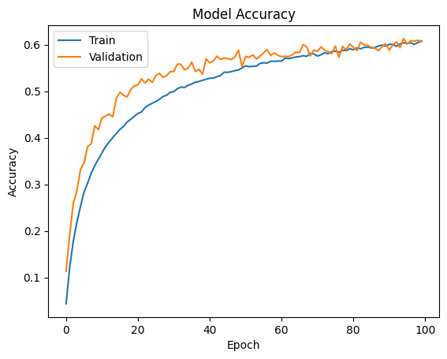

# CIFAR-100 CNN Experiments for Cognitive Robotics

**Selin Deniz İşken · University of Manchester · COMP34212 Cognitive Robotics**

A coursework study of how learning rate, batch size and dropout affect image classification with a convolutional neural network. The project connects visual recognition experiments with a literature review of deep learning for robotic perception.

The experiments use **CIFAR-100**, with 60,000 RGB images of size 32 × 32 across 100 fine-grained classes: 50,000 training images and 10,000 test images. Images are loaded through Keras, normalised to [0, 1], and labels are one-hot encoded. No dataset or trained weights are bundled.

## Start here

Open [the representative CNN notebook](notebooks/01_cifar100_cnn_baseline.ipynb) to inspect the complete pipeline and its saved results without running training. Six additional notebooks illustrate the three hyperparameter comparisons.

| Path | Contents |
| --- | --- |
| `notebooks/` | Representative baseline and six selected experimental runs |
| `results/reported_results.csv` | All nine result rows transcribed from the final report, including reported uncertainty |
| `results/preserved_runs.csv` | Exact printed evaluation values and actual code settings for the seven included notebooks |
| `results/original_results.xlsx` | Unmodified historical results workbook |
| `results/histories/` | Two original 100-epoch metric histories |
| `figures/` | Original learning-rate comparison and baseline plots extracted from saved notebook outputs |
| `docs/` | Final report, reference text, provenance and interpretation notes |

## Implementation

The Keras Sequential CNN has five 3 × 3 convolutional layers in three blocks: **64–64**, **128–128**, and **256** filters. ReLU activations, 2 × 2 max pooling and dropout follow the convolutional processing. A flattened representation feeds a **512-unit dense layer**, dropout and a **100-class softmax** output.

Training uses Adam and categorical cross-entropy for **100 epochs**. Augmentation applies rotations up to 15°, width/height shifts up to 10%, and horizontal flips. The representative configuration uses learning rate **0.0005**, batch size **128**, and dropout **0.25 / 0.30 / 0.40 / 0.50**.

## Reported experiments and findings

The **final submitted report is the reference for the experiments conducted and conclusions reported**. It describes five repetitions per configuration. Experiments were distributed across multiple computers and Google Colab accounts because of computational limitations. This repository preserves an accessible selection, rather than the complete execution archive. Missing notebooks do not establish that experiments were not performed.

The table below reproduces the report's test-accuracy and test-loss entries without recalculation. Full training and evaluation entries are in [reported_results.csv](results/reported_results.csv); the original report and workbook remain unchanged.

| Experiment | Setting | Reported test accuracy | Reported test loss |
| --- | --- | --- | --- |
| Learning rate | 0.0001 | 0.5673 ± 0.0011 | 1.6029 ± 0.0006 |
| Learning rate | 0.0005 | 0.6017 ± 0.0084 | 1.4627 ± 0.0299 |
| Learning rate | 0.001 | 0.5283 ± 0.0069 | 1.7839 ± 0.0398 |
| Batch size | 64 | 0.582 ± 0.0060 | 1.5502 ± 0.0237 |
| Batch size | 128 | 0.6017 ± 0.0084 | 1.4627 ± 0.0299 |
| Batch size | 256 | 0.6038 ± 0.0094 | 1.4561 ± 0.0514 |
| Dropout | Low: .20/.20/.30/.40 | 0.6055 ± 0.0065 | 1.5098 ± 0.0249 |
| Dropout | Baseline: .25/.30/.40/.50 | 0.6017 ± 0.0084 | 1.4627 ± 0.0299 |
| Dropout | High: .40/.50/.50/.60 | 0.5459 ± 0.0093 | 1.6933 ± 0.0532 |

The report identifies **0.0005** as the strongest learning rate in its comparison, recommends batch size **128** as a practical balance, and favours baseline dropout as a balance between learning capacity and regularisation. It interprets high dropout as underfitting and low dropout as more susceptible to overfitting. Longer training, alternative regularisation and learning-rate schedules are proposed as future work, not completed experiments.

There are historical inconsistencies to keep visible: the batch-size table gives 256 a slightly higher mean accuracy than 128, although the narrative favours 128; the low-dropout accuracy in the workbook differs from the report. These are preserved and explained in [the results notes](docs/RESULTS_NOTES.md), without substituting new aggregates.

## Preserved run example

The representative notebook records an evaluation accuracy of **0.6065000295639038** and loss of **1.4512799978256226**. These are one run's saved outputs, not the report's mean. Notebook selection is based on completeness and coverage; it is not a ranking of best runs.

## Technical contributions

My coursework extends the university's Keras CNN laboratory foundation to CIFAR-100: adapting the 100-class pipeline, expanding the convolutional blocks, configuring augmentation and regularisation, conducting hyperparameter experiments, and interpreting accuracy/loss behaviour in the context of robotic vision. The contribution is experimental implementation and analysis built on teaching material; the underlying CNN methods and laboratory foundation are credited below.

## Explore or reproduce

1. Browse the saved notebook outputs and read [the submitted report](docs/coursework_report.pdf). No execution is needed for review.
2. For a new run, use an isolated Python environment or upload a notebook to Colab. Install the imported libraries with `python -m pip install -r requirements.txt` and open notebooks with `jupyter notebook`.
3. Run the selected notebook from a fresh kernel. Training downloads CIFAR-100, can take substantial time, and benefits from a GPU. Save reruns under a new filename to preserve historical outputs.

`requirements.txt` is a minimal library list, not a recovered or tested environment lock. The original package versions were not recorded. The notebooks use the legacy `ImageDataGenerator` API, so an environment retaining that API is required. No models were trained or notebook cells executed during portfolio preparation. Exact numerical reproduction is not guaranteed: the selected notebooks do not fix random seeds, and historical hardware/accounts varied.

## Methodological limitations

- The preserved 100-epoch notebooks use the CIFAR-100 test set for validation during training and evaluate on the same set afterward. The historical values should be read as performance on that reused evaluation set, not an independent final-test estimate.
- Selected low/high-dropout code uses **batch size 125**, while the report describes 128. Preserve this difference when interpreting the dropout comparison.
- Accessible files are incomplete as an archive of the distributed experiments. Some saved notebook outputs are duplicates. They cannot independently reconstruct all repetitions or reported uncertainty, and are not treated as additional independent trials here.
- Historical progress-display values and final evaluation values can differ. This package preserves the report's original metric labels, but does not independently validate every aggregate or infer statistical significance.
- This is one CNN architecture family on one image benchmark. Robotics applications are motivation and literature context; no physical robot deployment was demonstrated.

## Attribution and publication status

The university CIFAR CNN lab identifies **Copyright (c) 2022 Angelo Cangelosi, MIT License**, with code/examples adapted from **Gulli & Pal (2017), Deep Learning with Keras**, and support from **Wenjie Huang**. Preserve these credits in any publication. See [provenance and publication notes](docs/PROVENANCE.md).

Complete upstream copyright and MIT licence notices are preserved in [THIRD_PARTY_NOTICES.md](THIRD_PARTY_NOTICES.md) and [licenses/Packt-MIT.txt](licenses/Packt-MIT.txt). The author's original coursework content retains its existing copyright; no additional repository-wide reuse licence has been assigned to it. The dataset is external and is not redistributed.

This package is prepared for public portfolio publication after the examination period under the University's [published guidance on student assessment content](https://www.staffnet.manchester.ac.uk/adviceandresponse/resources/types-of-potential-misbehaviour/). University questions, instructions, marking rubrics, feedback and full teaching notebooks are excluded. No COMP34212-specific prohibition on subsequent publication was found in the available documentation. The review and source boundaries are recorded in [provenance](docs/PROVENANCE.md). No GitHub repository has yet been created.
